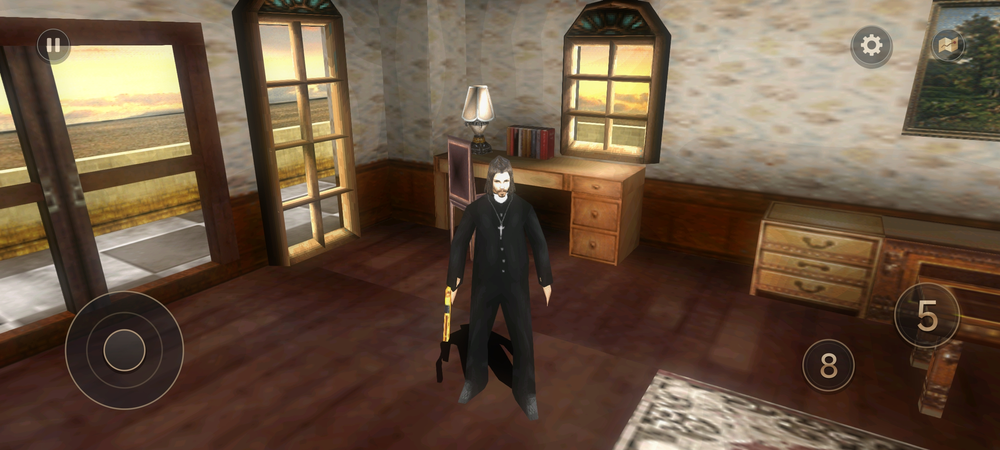

# 7Days-AN · 七夜 HD


塞班时代 3D 冒险名作《七夜》的安卓原生复刻。不是模拟器，不是 CPU 转译——通过逆向分析重写平台接口，让原版 ARM 引擎二进制直接运行在 Android 上。



## 这是什么

《七夜》（7Days）是丁果科技 2009 年发布于 Symbian 平台的 3D 冒险游戏，被誉为塞班时代的"3A 大作"。本项目将其移植为可独立安装的安卓 APK：

- **原生运行**：加载原 ARM Linux 引擎 ELF，完成重定位导入、部分 GLIBC/Bionic ABI 转换、SDL3 函数表替换，以及安卓 GLES 上下文与音频输出。游戏逻辑以原始机器码执行，**不做任何 CPU 模拟**，也无需 Vita3K 等模拟器。
- **逆向驱动**：使用 Ghidra 11.4.3 对原引擎自动分析，导出 5,079 个函数，其中 5,075 个成功反编译为伪代码；定位主入口、SPK 资源读取、字体、音频初始化等关键地址，并据此编写了 SPK 资源包解包工具（`spk_tool.py`）。
- **资源内置**：APK 内含引擎与资源包，首次启动校验 SHA-256 后复制到应用私有目录，装好即玩。

## 下载安装

从 [Releases](https://github.com/afeimod/7Days-AN/releases) 获取最新 APK：

| | |
|---|---|
| 当前版本 | v1.0（2026-11-22） |
| 安装包 | `Qiye-HD-1.0.apk`，约 37.6 MB |
| 系统要求 | Android 5.0+，且支持 32 位 ARM 应用 |
| 注意 | 仅含 `armeabi-v7a`，**仅 arm64 的设备无法安装**；应用为横屏 |

安装后打开应用，等待首次数据准备完成即可进入主菜单。

## 操作

| 操作 | 按键 / 触控 |
|---|---|
| 移动 / 菜单选择 | 左侧八向摇杆（支持斜向、死区、多点触控） |
| 确认 / 交互 / 推进对话 | A 或右侧"动作"键 |
| 物品 / 返回 | B |
| 地图 | 地图 |
| 返回 | 返回 |
| 滤镜选择 | "画面"按钮，设置自动保存 |

虚拟按键支持多点同时按压；切到后台自动释放全部按键，避免"卡键"。

## 主要特性

- **中文修复**：原引擎只能识别有限拉丁字形，中文会丢失。适配层为原始位图分配一致的私用区码点，剧情解析与字体图集共享映射（非 OCR）。菜单中文已实测，全部剧情仍需进一步验证。
- **声音修复**：原 N900 引擎会将 SDL 音频驱动主动设为 dummy；适配层拦截该设置，改用 AAudio / OpenSL ES 输出。已验证 12,000 Hz 单声道 S16LE PCM 队列消耗（未做人工听音验证）。
- **高清渲染**：关闭原引擎 320×240 低清模式，按屏幕实际尺寸渲染；2× 模式对场景超采样（2560×1440 屏下场景缓冲达 5120×2880，受 GPU 上限约束）。原有低清纹理不会因此凭空增加细节。
- **宽高比适配**：自动适配横屏、16:9、4:3、5:3；3D 投影与 UI 横向比例按屏幕宽高比修正。
- **滤镜**：原始、xBR、HQ2x、Dot 点阵、扫描线，全尺寸帧后处理。滤镜着色器来自 libretro/glsl-shaders（MIT 许可），已改写为 GLES 2.0 兼容表达式。
- **虚拟按键自定义**：金属质感按键带按下反馈；透明度 10%–100%、大小 50%–160% 可调，摇杆和每个按键均可拖动位置，自动限制在屏幕内，支持恢复默认。

## 已验证 / 未验证

**已验证**（Android 7.0 / API 24 ARMv7 模拟器 + 雷电 9 横屏 2560×1440）：

- APK v1/v2/v3 签名校验，adb 安装；首次启动校验并复制资源，引擎加载 3,322 个资源、67 件物品、581 条系统文字
- 原生静态初始化与 main 入口、主菜单 3D 场景
- New Game 进入第一天开场与 `day1/2008` 房间；对话推进、移动、物品、地图、设置页
- 存档 / 读档完整回路（生成 45,742 字节 JSON 存档并通过解析校验）
- Home 切后台再恢复；强制停止后读档回到保存位置
- xBR / HQ2x 滤镜切换（GLES error=0）

**未验证**：第二天及后续关卡、战斗、完整通关、实体手机性能、更高版本 Android、多指同时按压的设备端效果。详见 [`Hebdomad-android/validation/`](Hebdomad-android/validation/) 中的截图、日志与逐项结果。

更多运行截图：

| 主菜单 | 地图 | 物品栏 |
|---|---|---|
|  |  |  |

## 从源码构建

Windows PowerShell，先安装 Python 3、JDK 21、Android SDK platform android-35 / build-tools 35.0.1、NDK r27d：

```powershell
$env:ANDROID_SDK_ROOT='你的 Android SDK 目录'
$env:ANDROID_NDK_HOME='你的 NDK r27d 目录'
$env:JAVA_HOME='你的 JDK 21 目录'
python build.py
```

输出 `build/Hebdomad-experimental.apk`。`third_party/SDL3-3.4.20.aar`、头文件、dynapi 表及 `assets/engine.arm`、`assets/res.spk` 均已附带，可完整重现构建。构建脚本会自行生成开发签名私钥，与发布签名不一致，覆盖安装前需卸载（会删除存档）。

## 仓库结构

```
7Days-AN/
├── README.md                  # 本文件
├── Hebdomad-android/          # 安卓移植：Java/C++ 适配源码、构建脚本、资源与验证记录
│   ├── java/  native/         # 新增平台适配层源码
│   ├── assets/                # engine.arm 与 res.spk
│   ├── third_party/           # SDL3 3.4.20 与滤镜着色器
│   ├── validation/            # 测试截图、日志与逐项结果
│   └── build.py               # 构建入口
└── reverse-engineering/       # 逆向分析记录与产物（伪代码，不可编译）
```

注意：`reverse-engineering/recovered.c` 是 Ghidra 导出的分析用伪代码，不能编译，也不是原作者源码。本项目没有完成整个引擎的源码重建。

## 来源与许可

- 原引擎提取自 [0x4d696e68/Hebdomad](https://github.com/0x4d696e68/Hebdomad) v1.1.0 的 ARM Linux DEB 包；游戏数据来自用户提供的七夜数据包。
- 原游戏及移植发布物的权利归相应权利人所有，本项目不授予其再分发许可。
- SDL3 采用 zlib 许可（见 `third_party/SDL-LICENSE.txt`）；滤镜着色器来自 libretro/glsl-shaders（xBR by Hyllian、HQ2x by Lior Halphon / hunterk，MIT 许可）。
- 当前 APK 使用开发签名并开启调试，便于收集错误日志。
