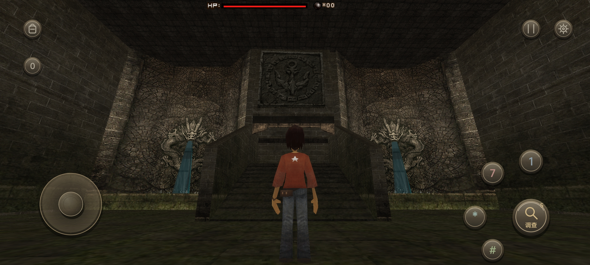

# 孤岛悲歌 · Lament Island HD

塞班时代 3D 冒险名作《孤岛悲歌》的安卓原生复刻。不是模拟器，不是 CPU 转译——通过逆向分析重写平台接口，让原版 ARM 引擎二进制直接运行在 Android 上。

## 这是什么

《孤岛悲歌》（Lament Island）是2008年由国产开发商新热力（Simlife）打造的一款真3D动作解谜手游，在当时被视为塞班平台上的顶级大作之一。本项目将其移植为可独立安装的安卓 APK：

- **资源内置**：APK 内含引擎与资源包，首次启动校验 SHA-256 后复制到应用私有目录，装好即玩。

## 下载安装

从 [Releases](https://github.com/afeimod/7Days-AN/releases/download/%E5%AD%A4%E5%B2%9B%E6%82%B2%E6%AD%8C-0.4/island-0.4.apk) 获取最新 APK：

| | |
|---|---|
| 当前版本 | v1.0（2026-11-22） |
| 安装包 | `island-0.4.apk` |
| 系统要求 | Android 5.0+，且支持 32 位 ARM 应用 |

安装后打开应用，等待首次数据准备完成即可进入主菜单。

